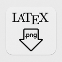
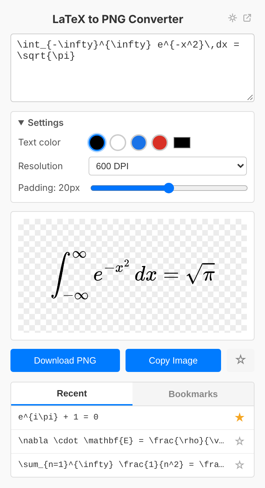
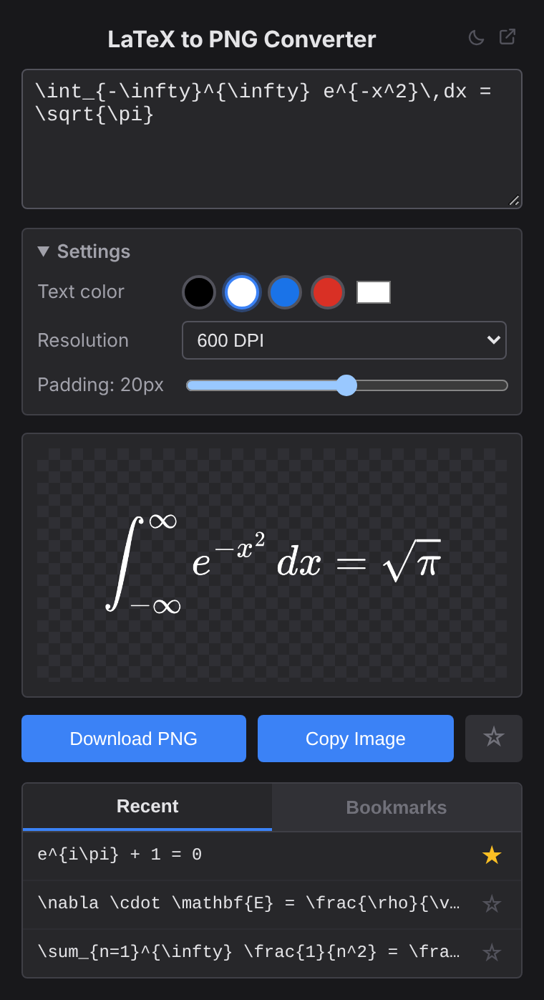
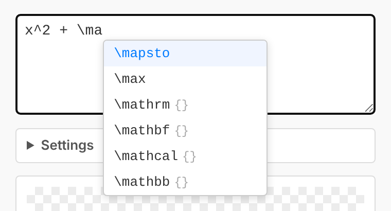

<p align="center">
  
</p>

<h1 align="center">LaTeX to PNG — Chrome Extension</h1>

<p align="center">
  A lightweight Chrome extension that turns LaTeX math into high-resolution, transparent PNGs —
  ready to paste into slides, documents and notes.
</p>

<p align="center">
  <a href="#installation">Installation</a> ·
  <a href="#features">Features</a> ·
  <a href="#build">Build</a> ·
  <a href="https://github.com/gabrielesano/latextopng_app">Desktop app</a>
</p>

<p align="center">
  
  
</p>

## Features

- **Live preview** while you type, rendered offline with MathJax (including Dirac braket notation)
- **150 / 300 / 600 DPI** export with a transparent background. The DPI is stored in the PNG, so Word, PowerPoint & co. insert it at the right size
- **Text colour** (black, white, blue, red or any custom colour) and **padding** (0–40 px) settings
- **Download or copy** the PNG with one click, with visual confirmation (or an error) on the button
- **Clear error messages** for invalid LaTeX (e.g. *Missing close brace*) instead of a broken image
- **Autocomplete** for common commands, plus automatic closing of brackets and `\begin{…}` environments

  

- **History** of your last 5 equations (saved on download or copy) and **bookmarks** to keep your favourites
- **Draft persistence**: close and reopen the popup without losing your formula
- **Light, dark or system theme**, applied before the popup paints (no flash)
- **Open in tab** for more room
- **Offline**: MathJax is bundled, no internet required and no data leaves your browser

### Example output

<picture>
  <source media="(prefers-color-scheme: dark)" srcset="docs/images/example-output-white.png">
  
</picture>

```latex
f(x) = \frac{1}{\sigma\sqrt{2\pi}} \, e^{-\frac{(x-\mu)^2}{2\sigma^2}}
```

## Installation

1. Download or clone this repository (the ready-to-load package is `arc.zip`: extract it to a folder)
2. Open `chrome://extensions/` in Chrome (or Brave, or any Chromium browser)
3. Enable **Developer mode** (toggle in the top right)
4. Click **Load unpacked** and select the extension folder
5. The extension icon appears in your toolbar. Click it to start

## Usage

Click the extension icon, then type or paste any LaTeX math expression: the preview updates in real time.

- Start typing `\` followed by letters to get command suggestions. Navigate with <kbd>↑</kbd> <kbd>↓</kbd>, accept with <kbd>Tab</kbd> (or <kbd>Enter</kbd> on a highlighted item) and dismiss with <kbd>Esc</kbd>.
- Typing `(`, `[`, `{` (or their `\`-prefixed variants) inserts the matching closer and wraps any selected text. Typing `\begin{align}` + <kbd>Enter</kbd> inserts the matching `\end{align}`.
- Use the **Settings** panel to change text colour, resolution and padding.
- Click **Download PNG** to save or **Copy Image** to copy to the clipboard. Click ☆ to bookmark an equation.

## Build

To package the extension for distribution:

```bash
bash build.sh
```

This creates `arc.zip` containing all the files the extension needs. There is no other build step: the extension is plain HTML, CSS and JavaScript.

Optional checks (`npm install` first): `npm run lint` and `npm run validate`.

## How it works

```
LaTeX → MathJax (SVG) → canvas at the chosen DPI → PNG + pHYs (DPI) chunk
```

Everything runs locally in the popup. The extension is built with [MathJax 3](https://www.mathjax.org).

## License

[MIT](LICENSE) © Gabriele Sano.
The bundled MathJax library is licensed under Apache 2.0 ([notice](lib/LICENSE-MathJax.txt)).
